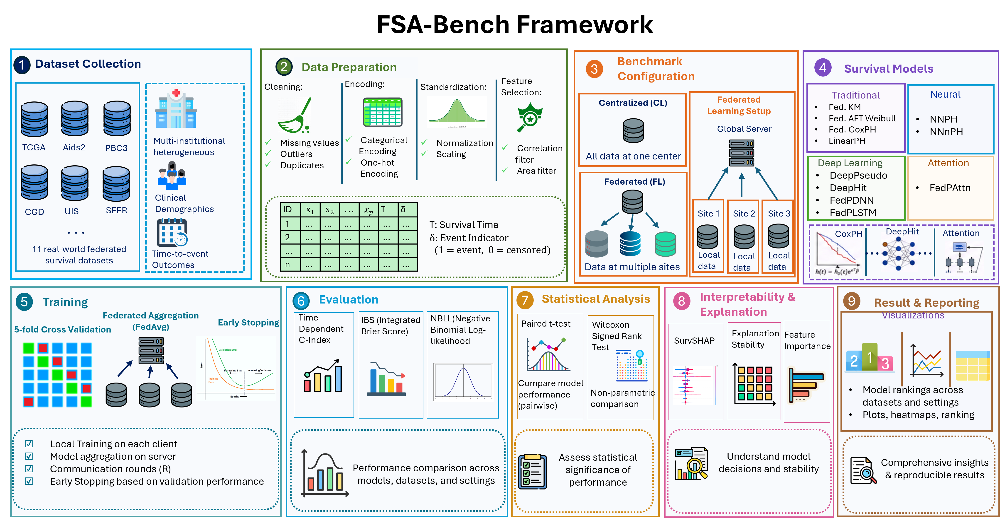

# FSA-Bench: Benchmarking Federated Survival Models

## 

[](https://www.python.org/downloads/)
[](https://pytorch.org/)
[](https://www.mathworks.com/products/matlab.html)
[](https://opensource.org/licenses/MIT)
[](https://arxiv.org/abs/2024.xxxx)

## 🎯 Overview 
Recent efforts in the literature have explored survival
models, but several key gaps remain:

-   **Lack of comprehensive comparison**: No prior study has
    benchmarked a wide range of survival modeling methods within a
    single paper in federated settings. 
-   **Limited datasets** -- Most existing works have only been
    tested on a few datasets, restricting their applicability in
    different fields of research domains. 

### 📌 Our Contribution

In this work, we present:

-   A **comprehensive benchmarking analysis** of **Federated Survival
    Models** using the **SurvSet repository**.\
-   A **performance comparison** against **state-of-the-art neural
    network-based federated Cox proportional hazard models**.

This study provides deeper insights into the strengths and weaknesses of
different survival methods, helping researchers make **better-informed
decisions in healthcare applications**.

## 🏗️ Architecture Pipeline of FSA-Bench Framework




## 🚀 Installation
### From source
Download a local copy of FSA_Bench from the directory and install it from that local copy:

```bash
	git clone https://github.com/umbc-sanjaylab/FSA_Bench.git
	cd FSA_Bench
	pip install -r requirements.txt
```

### Configure the environement
```bash 
conda create -n FSA_Bench python=3.10
conda activate FSA_Bench
pip install -r requirements.txt
``` 

## 📊 Dataset

In our designed FSA-Bench framework, we evaluate federated survival models on **10 real-world federated survival datasets** covering diverse clinical domains, patient populations, sample sizes etc.

To emulate realistic federated healthcare environments, naturally occurring institutional or geographically defined partitions are preserved whenever available. This allows FSA-Bench to evaluate survival models under heterogeneous and non-IID data distributions across multiple clients.

### Dataset Summary

| Dataset | Samples | Variables | Event (%) | Censoring (%) | # Clients | Data Link |
|---|---:|---:|---:|---:|---:|---|
| **TCGA** | 6,084 | 283 | 30.50 | 69.50 | 7 | [Link](https://www.cancer.gov/ccg/research/genome-sequencing/tcga) |
| **Aids2** | 2,839 | 3 | 62.03 | 37.97 | 4 | [Link](https://rdrr.io/cran/MASS/man/Aids2.html) |
| **LeukSurv** | 1,043 | 4 | 84.28 | 15.72 | 24 | [Link](https://rdrr.io/cran/spBayesSurv/man/LeukSurv.html) |
| **Pbc3** | 349 | 12 | 17.48 | 82.52 | 6 | [Link](https://www.rdocumentation.org/packages/pec/versions/2025.06.24/topics/Pbc3) |
| **Dialysis** | 6,805 | 2 | 23.56 | 76.44 | 67 | [Link](https://rdrr.io/cran/RcmdrPlugin.survival/man/Dialysis.html) |
| **Oropharyngeal Carcinoma** | 192 | 12 | 72.40 | 27.60 | 6 | [Link](https://rdrr.io/cran/invGauss/man/d.oropha.rec.html) |
| **cgd** | 128 | 8 | 34.38 | 65.62 | 4 | [Link](https://rdrr.io/cran/survival/man/cgd.html) |
| **uis** | 628 | 7 | 80.89 | 19.11 | 2 | [Link](https://github.com/graemeleehickey/hosmer-lemeshow/blob/master/edition2/uis.txt) |
| **scania** | 1,040 | 4 | 52.60 | 47.40 | 5 | [Link](https://cran.r-project.org/web/packages/eha/refman/eha.html#scania) |
| **SEER** | 25,749 | 11 | 25.36 | 74.64 | 3 | [Link](https://seer.cancer.gov/) |

The datasets span a wide range of federation settings, from **2 clients
(UIS)** to **67 clients (Dialysis)**, and include both relatively small
cohorts such as **cgd (128 samples)** and large-scale datasets such as
**SEER (25,749 samples)**. The varying event and censoring rates enable
evaluation of model robustness under heterogeneous survival conditions.


## 📈 Evaluation

### Comprehensive Metrics

- **Concordance Index**: Assesses how well a model can predict survival times close to the truth. 
- **Brier Score**: Measures the accuracy of the predicted survival
probability for a sample at a given time. 
 
## 📋 Requirements

```
jupyter==1.0.0
pycox==0.2.3
torch==2.0.1
scikit-learn==1.2.2
pandas==1.3.5
numpy==1.24.3 
```

## 📄 License

This project is licensed under the lab of UMBC Professor Sanjay Lab - see the [LICENSE](LICENSE) file for details.

**FSA-Bench** - A benchmark study of existing federated survival models. 
